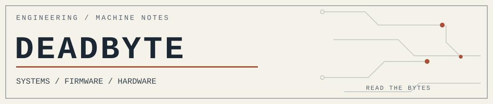

<picture>
  <source media="(prefers-color-scheme: dark)" srcset="assets/deadbyte-dark.svg">
  <source media="(prefers-color-scheme: light)" srcset="assets/deadbyte-light.svg">
  
</picture>

# DEADBYTE

**Independent systems engineering · Thailand**  
C / Rust / x86 assembly / firmware / native Windows / Linux / PCB design

I'm interested in the things under the interface: how a program gets loaded, why an instruction behaves the way it does, what a firmware image really contains, and whether a piece of hardware does what its schematic says.

I've written compilers, boot code, desktop utilities, binary formats, test harnesses and more than a few things that probably already exist. Rebuilding them is how I learn where the sharp edges are. I would rather have a small program I can explain than a large one I have to trust.

Terry A. Davis is a major influence on the way I think about computers. Not because every machine should be TempleOS, but because he took understanding his own stack seriously. That's the part I want to carry forward.

> Most people write code to solve problems. I write code because I don't want to depend on anyone else's software.

[Projects](#the-projects) · [Engineering notes](#from-the-workbench) · [DByte](https://dbytelang.site) · [All public repositories](https://github.com/Deadbytes101?tab=repositories)

## What I spend my time on

I work independently across software and hardware. My working environment has included Windows, Linux, WSL, QEMU, old BIOS machines, modern development PCs, logic-level debugging, ROM programmers, and KiCad. I use C17, Rust, assembly, Python, PowerShell and shell scripting as the job requires.

The interesting work usually crosses a boundary:

- **Compilers and operating systems.** Lexing, parsing, type checking, machine code, bytecode VMs, boot sectors, memory management, executable formats, filesystems, and the first screen of text after a machine boots.
- **Native software.** Win32 windows and controls, disk access, PE images, network sockets, error paths, packaging and rollback. I prefer direct system APIs to dragging in a browser runtime for a small utility.
- **Firmware and old hardware.** Reading ROMs, comparing raw dumps, looking at disassembly, matching datasheet pins to schematics, tracing power/reset logic and checking what an actual board does.
- **Graphics.** CPU rasterization, framebuffer formats, fixed-point arithmetic, old GPU architectures and the RTL needed to move pixels without hiding the pipeline.
- **Testing the claims.** Build logs, exact input/output bytes, hashes, memory traces, readback verification, regression tests and benchmarks with named conditions. A green badge by itself doesn't tell me very much.

I also maintain and troubleshoot my own Windows/Linux machines: boot failures, unstable CPU settings, thermals, storage, memory, firmware and network problems. That work is less glamorous than writing a kernel, but it teaches the same lesson: measure first.

## From the workbench

A few concrete things from the public source trees, rather than a list of technologies I claim to know:

| Work | Observed or documented boundary |
| --- | --- |
| [BONEBOX-01](https://github.com/Deadbytes101/BONEBOX-01) | x86 real-mode boot sector, nucleus and shell; **99/99** host tests and a documented interactive QEMU boot. |
| [DEADFLASH](https://github.com/Deadbytes101/DEADFLASH) | C17/Win32 disk-image writer; target revalidation, flush/readback checks and **7/7** CTest checks in the repository's release evidence. |
| [DEADWIRE-HTTPD](https://github.com/Deadbytes101/DEADWIRE-HTTPD) | Small HTTP/1.0 server; explicit Windows/Linux backends and **21** hostile-path test cases. Benchmarks are tied to specific builds and test lanes. |
| [S3CORE01](https://github.com/Deadbytes101/S3CORE01) | Four-layer SG2002/RV64 board: **0 DRC violations and 0 unconnected items** in the recorded routed CAD check. **Not physically brought up.** |
| [CINDER-16](https://github.com/Deadbytes101/CINDER-16) | 16-bit virtual machine in Io with strict image loading, instruction trace and reverse-step debugger. |
| [A780L3B BIOS research](https://github.com/Deadbytes101/dbyte-a780l3b-bios-research) | ROM comparisons, patched firmware paths, hashes and physical chip-read checks; conclusions are limited to the tested board and firmware revisions. |

<details>
<summary><b>My bench rule</b> — the short version</summary>

```text
READ THE SOURCE
READ THE DATASHEET
READ THE BYTES

BUILD  ->  RUN  ->  MEASURE  ->  VERIFY

NO RESULT WITHOUT A TEST.
NO HARDWARE CLAIM WITHOUT HARDWARE.
NO "FASTER" WITHOUT A FAIR BENCHMARK.
```

</details>

## The projects

These are the **23 public project repositories** in my GitHub inventory, grouped so you can find something without scrolling through a wall of logos. Some are released tools; others are research, unfinished hardware, or deliberately frozen experiments. Their own READMEs describe what actually works.

### Languages, operating systems, machines

- **[DBYTE](https://github.com/Deadbytes101/DBYTE)** — My systems language and toolchain: lexer, parser, type checker, interpreter, bytecode compiler/VM, native experiments and a separate kernel lab. The public tree is a working snapshot, not every private development branch.
- **[BONEBOX-01](https://github.com/Deadbytes101/BONEBOX-01)** — A boot-sector-up x86 real-mode system with a small nucleus, transient shell, BFS1 filesystem and BEX1 executable overlay. I wanted to see how much machine I could own in a tiny address space.
- **[LOOM](https://github.com/Deadbytes101/LOOM)** — An x86-64 operating-engine experiment built from replaceable cells rather than a conventional resident kernel. Fault handling and generational replacement are ongoing work.
- **[SHINESEA](https://github.com/Deadbytes101/SHINESEA)** — Rust filesystem-image core with contiguous extents, checksums, mirrored catalogs and recovery rules. Verification is ahead of the planned 1.0 release.
- **[CINDER-16](https://github.com/Deadbytes101/CINDER-16)** — A small 16-bit virtual machine written in Io: fixed instructions, deterministic execution, a debugger that can go backwards.
- **[DBLYATEM](https://github.com/Deadbytes101/DBLYATEM)** — C and Linux-side experiments with PE/AMD64 parsing and strict binary-image verification. Not a completed Windows compatibility layer.
- **[DBYTE-HOLYC-OPT](https://github.com/Deadbytes101/DBYTE-HOLYC-OPT)** — Research on improving HolyC optimization inside the original intermediate-code and native backend structure. This is early, source-level work; Terry's compiler is the reference.

### Native programs and network tools

- **[DBYTEPAD](https://github.com/Deadbytes101/DBYTEPAD)** — A Win32 editor in C with file operations, search, diff and optional DByte integration. Also a size experiment: the tiny releases have different, explicitly stated capabilities.
- **[DEADFLASH](https://github.com/Deadbytes101/DEADFLASH)** — A USB-image writer, verifier and removable-disk utility. It checks the target again before destructive operations and reads back what it wrote.
- **[DEADBYTE-RECLAIM](https://github.com/Deadbytes101/DEADBYTE-RECLAIM)** — Windows inventory, uninstall and rollback software. Plain Win32 UI; the CLI owns the mutation policy.
- **[DBNET](https://github.com/Deadbytes101/DBNET)** — Network diagnostics and throughput probes on Windows, with reproducible package provenance and explicit consent where third-party test services retain data.
- **[DEADWIRE-HTTPD](https://github.com/Deadbytes101/DEADWIRE-HTTPD)** — A small HTTP/1.0 static server with assembly-heavy paths, strict path handling and measured benchmarks.
- **[BYTE-KEEPER](https://github.com/Deadbytes101/BYTE-KEEPER)** — M0TE, a tiny digital organism living in a native Rust habitat. Persistent state, a taskbar companion and a deliberately bounded little world.

### Graphics, pixels and silicon

- **[DEADGL](https://github.com/Deadbytes101/DEADGL)** — C99 CPU renderer. A text command stream becomes framebuffer bytes, images and proof hashes. No GPU API required.
- **[DGP-1](https://github.com/Deadbytes101/DGP-1)** — Fixed-function GPU design: command FIFO, raster rules, two texture lanes, scanout, MMIO and FPGA-targeted RTL. Verification models exist; it is **not** a finished graphics card.
- **[dbyte-dbpx](https://github.com/Deadbytes101/dbyte-dbpx)** — A simple lossless raster-image format for pixel art, screenshots and debug frames, with a decoder designed to be readable and strict.

### Circuit boards, BIOS and the physical machine

- **[DBYTE-370](https://github.com/Deadbytes101/DBYTE-370)** — A Pentium III Socket 370 ATX motherboard design using VIA north/southbridge chips, SDRAM and AGP. Pin contracts, power and clock questions come before routing.
- **[S3CORE01](https://github.com/Deadbytes101/S3CORE01)** — An SG2002-based small RV64 computer board. Routed CAD and design-rule evidence exist; first hardware boot remains to be demonstrated.
- **[USBDEADFLASH](https://github.com/Deadbytes101/USBDEADFLASH)** — A USB 3.0 flash-drive PCB project. Connector, impedance, controller and NAND decisions are engineering problems, not a product photo.
- **[dbyte-a780l3b-bios-research](https://github.com/Deadbytes101/dbyte-a780l3b-bios-research)** — BIOSTAR A780L3B firmware work: ROM dumps, hex-level differences, register paths and recovery notes. A programmer and a verified read are worth more than a guessed patch.

### Side projects and closed chapters

- **[RIGOS](https://github.com/Deadbytes101/RIGOS)** — A local-first, USB-bootable CPU mining appliance project. Still experimental.
- **[JOBSIM-DESKTOP](https://github.com/Deadbytes101/JOBSIM-DESKTOP)** — Native keyboard/mouse work for Job Simulator, kept as an engineering-alpha archive after development was closed.
- **[shower-game-remastered-2015](https://github.com/Deadbytes101/shower-game-remastered-2015)** — A clean-room remake/remaster study. Research and provenance planning, not a finished game or a redistribution of the original assets.

## A note on experience

I don't have a neat division between "software" and "hardware". Writing a loader leads to reading a datasheet. Debugging a disk utility leads to studying caches and write barriers. Designing a board leads back to boot ROMs and reset sequences.

Outside the public repositories, I have also worked on PC fault diagnosis, BIOS and EEPROM reading with a CH341A programmer, a four-layer ESP32-S3 controller-board CAD package, and stepper-driven mechanical experiments. Those are hands-on projects, not claims of finished commercial products.

My tools tend to be unromantic: a text editor, compiler, debugger, multimeter, ROM dump, KiCad, QEMU, and a test log. If a part is still simulated, I say so. If an experiment fails, I keep the evidence.

<details>
<summary><b>Courses and certificates</b> — links and exact credential types</summary>

| Course | Issuer | Record |
| --- | --- | --- |
| [MIPS Computer Architecture and Performance Optimization](https://www.coursera.org/verify/2DSRTVQR57DL) | BITS Pilani / Coursera | Course certificate |
| [Google IT Support](https://www.coursera.org/verify/professional-cert/KVMFVDKBTTDL) | Google / Coursera | Professional certificate |
| [IBM IT Support](https://www.coursera.org/verify/professional-cert/GNPDQ9N8IBFD) | IBM / Coursera | Professional certificate |
| [CompTIA A+ Core 1 coursework](https://www.coursera.org/verify/specialization/MKCQF06B5GH6) | Total Seminars / Coursera | Coursework specialization — **not** CompTIA certification |
| [Computer and ICT Literacy Skills (45 hours)](https://learner.thaimooc.ac.th/credential-wallet/a98d5c90-68cb-47b2-897e-0ce9aa35da1a/poongsak.phu/public) | Khon Kaen University / Thai MOOC | Certificate of completion |

</details>

---

*If you want to know whether something works, open the repository. Read the code and the tests. That's why they're there.*
